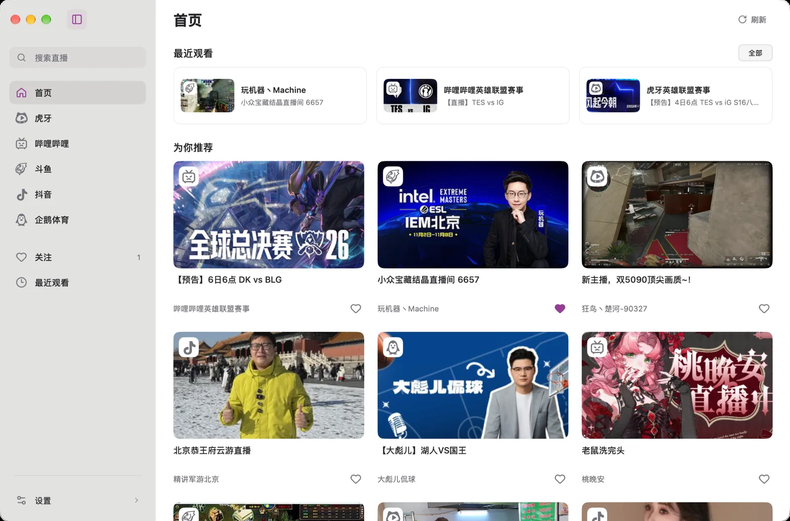
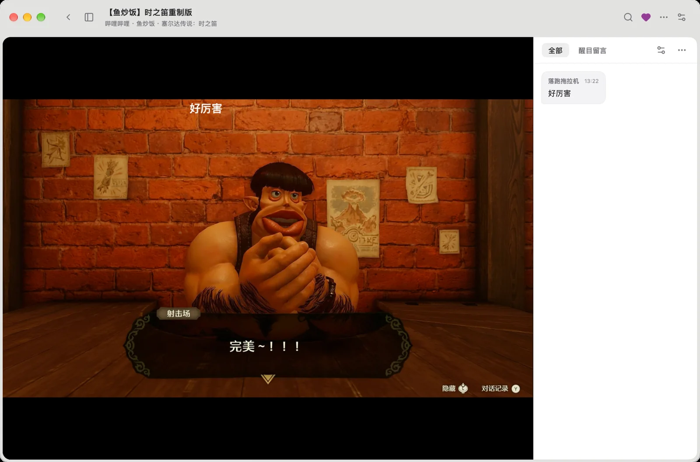

<div align="center">


# Live MyGo

**在桌面上，好好看直播。**

基于 [MyGo](https://github.com/egoist/mygo) 构建的原生多平台直播播放器。  
支持 macOS 与 Windows，提供直播浏览、弹幕、关注管理和播放控制。

[](https://github.com/anamaxlec/live-mygo/releases)
[](https://github.com/anamaxlec/live-mygo/stargazers)
[](LICENSE)

**[下载 macOS](https://github.com/anamaxlec/live-mygo/releases/download/v0.4.2-beta.3/LiveMyGo-v0.4.2-beta.3-macos-arm64.dmg)** · **[下载 Windows](https://github.com/anamaxlec/live-mygo/releases/download/v0.4.2-beta.3/LiveMyGo-v0.4.2-beta.3-windows-amd64-setup.exe)** · [所有版本](https://github.com/anamaxlec/live-mygo/releases) · [反馈问题](https://github.com/anamaxlec/live-mygo/issues)

</div>

---

## 界面预览

<p align="center">
  
  <br>
  <sub>首页 · 最近观看与直播推荐</sub>
</p>

<p align="center">
  
  <br>
  <sub>直播间 · 播放器与弹幕并排呈现</sub>
</p>

支持浅色、深色和跟随系统外观。播放器提供悬浮控制条，直播间可同时显示视频与弹幕列表。

## 主要功能

- **直播浏览与搜索。** 浏览推荐与分区、跨平台搜索主播；支持房间号和直播链接直达。
- **播放控制。** 切换清晰度、播放线路与画面比例；macOS 可选 mpv 或原生硬解内核，断流时尝试自动恢复。
- **弹幕设置。** 画面弹幕与右侧聊天列表独立设置，支持气泡 / 紧凑样式、字号与透明度调整，以及用户、关键词和重复内容过滤。
- **关注管理。** 收藏、分组、置顶、设置别名，按需刷新开播状态；可以为指定关注开启开播提醒。
- **桌面观看。** 置顶小窗、只听声音、定时停止，最多同时打开三个直播窗口；还能在看直播时继续浏览其他房间。
- **系统媒体控件。** macOS 和 Windows 的播放控件可显示房间标题与封面。macOS 27.3 支持菜单栏「播放中」实时活动。
- **本地数据与保存。** 导入导出关注与设置、可选静音恢复上次直播；账号信息加密存储在本地。支持保存当前画面，以及测试中的约 30 秒直播片段功能。

> Live MyGo 仍处于 **Beta 测试阶段**。不同平台提供的画质、线路与弹幕能力可能不同，部分功能仍在验证中。具体进展见 [产品进展](docs/PRODUCT-NEXT.md)。

## 下载与安装

当前测试版：[0.4.2-beta.3](https://github.com/anamaxlec/live-mygo/releases/tag/v0.4.2-beta.3)。

- **macOS** · Apple Silicon，macOS 27.0+：[DMG](https://github.com/anamaxlec/live-mygo/releases/download/v0.4.2-beta.3/LiveMyGo-v0.4.2-beta.3-macos-arm64.dmg) · [ZIP](https://github.com/anamaxlec/live-mygo/releases/download/v0.4.2-beta.3/LiveMyGo-v0.4.2-beta.3-macos-arm64.zip)
- **Windows** · x64：[安装程序](https://github.com/anamaxlec/live-mygo/releases/download/v0.4.2-beta.3/LiveMyGo-v0.4.2-beta.3-windows-amd64-setup.exe) · [便携 ZIP](https://github.com/anamaxlec/live-mygo/releases/download/v0.4.2-beta.3/LiveMyGo-v0.4.2-beta.3-windows-amd64.zip)

**macOS：** 打开 DMG，将 Live MyGo 拖入「应用程序」。目前采用 ad hoc 签名，尚未进行 Apple 公证；如果首次启动受到系统阻止，可前往「系统设置 → 隐私与安全性」手动允许打开。

**Windows：** 运行安装程序即可安装到当前用户环境，无需管理员权限；便携版解压后运行 `LiveMyGo.exe`。

## 快捷键

以下以 macOS 为例，Windows 使用对应平台快捷键。

| 操作 | 快捷键 |
| --- | --- |
| 快捷搜索 | `⌘ L` / `⌘ K` |
| 暂停 / 继续 | `Space` |
| 静音 / 取消静音 | `M` |
| 显示 / 隐藏画面弹幕 | `D` |
| 唤出播放控制条 | `K` / `Tab` |
| 刷新 / 重新连接 | `⌘ R` |
| 全屏 | `⌃ ⌘ F` |
| 设置 | `⌘ ,` |

## 从源码构建

项目使用 **Go + MyGo + libmpv**。macOS 构建环境需要 Go 1.27.3、Homebrew 安装的 `mpv` / `ffmpeg`，以及 Xcode Command Line Tools。

```sh
go test ./...
sh scripts/build.sh
open build/LiveMyGo.app
```

打包 DMG、Windows 构建与平台验证说明可查阅 [macOS 文档](docs/macos/README.md) 和 [Windows 文档](docs/windows/README.md)。项目的界面约定与技术记录分别见 [设计准则](docs/DESIGN.md) 和 [MyGo 技术参考](docs/MYGO.md)。

## 关于这个项目

Live MyGo 最初用于学习 **MyGo 原生 UI、libmpv 播放器集成和弹幕绘制**。目前项目持续开发 macOS 与 Windows 桌面版本，并完善播放控制、窗口交互和键盘操作。

它是非官方第三方客户端，与直播内容来源没有隶属或授权关系。

项目以 [GNU AGPL v3](LICENSE) 开源；第三方依赖与许可证见 [THIRD_PARTY.md](THIRD_PARTY.md)。

感谢 [MyGo](https://github.com/egoist/mygo)、[mpv](https://github.com/mpv-player/mpv)。项目在功能与体验上也参考了 [纯粹直播（Pure Live）](https://github.com/liuchuancong/pure_live)、[Simple Live](https://github.com/xuanxuan123xuan/dart_simple_live)、[MyGo CloudMusic](https://github.com/egoist/mygo-cloudmusic) 和 [IINA](https://iina.io/)。
